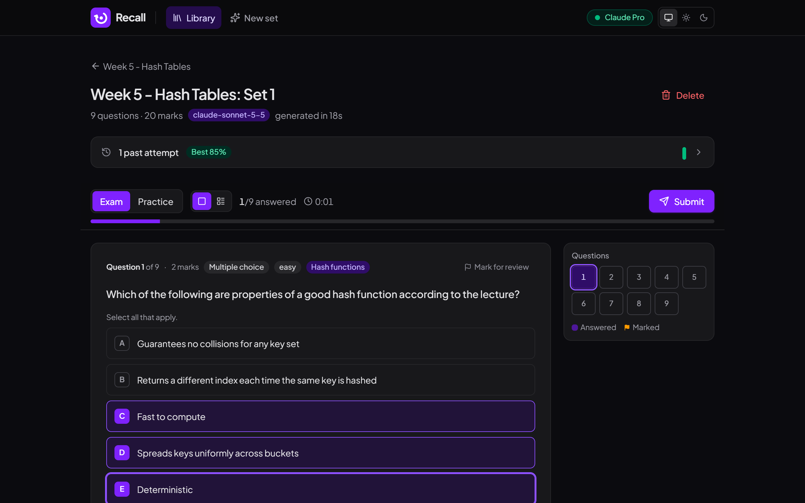
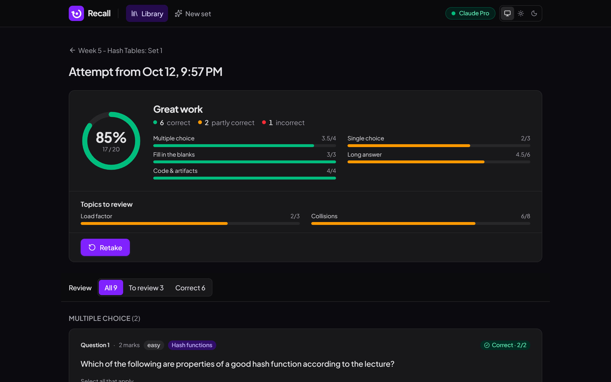
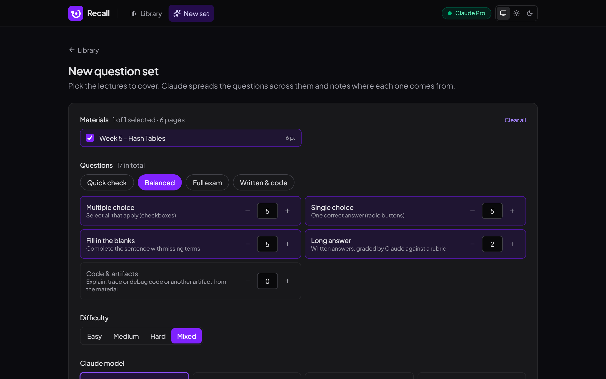
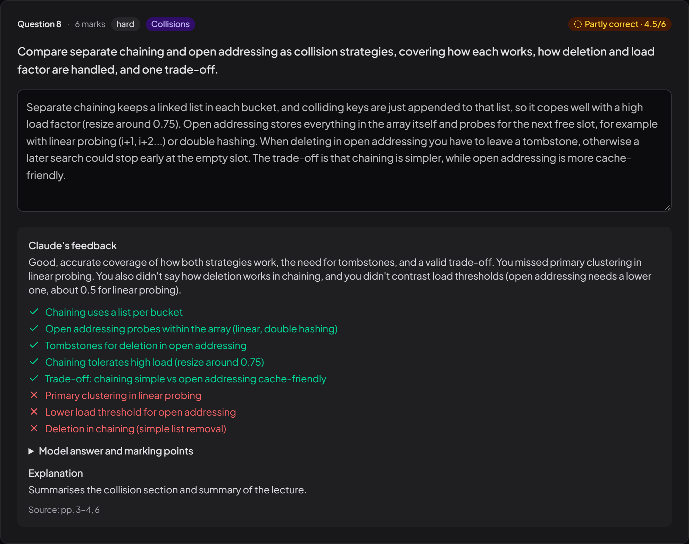

# Recall

Turn your lecture PDFs into practice exams. Claude writes multiple choice, single choice, fill-in-the-blank, long answer and code questions from your material, then grades your answers with feedback.

It runs on your own computer and uses your **Claude Pro or Max subscription** through Claude Code. No API key, no extra billing, and your files never leave your machine except to be read by Claude.

[](https://youtu.be/_3X7cHaQMOg)

▶️ [Watch the launch video](https://youtu.be/_3X7cHaQMOg)

| Take the exam | Get graded with feedback |
| --- | --- |
|  |  |
| **Choose what to generate** | **Claude marks written answers against a rubric** |
|  |  |

## Features

- **Works for any subject:** maths, engineering, nursing, science, business, law, humanities or computing. Claude writes questions the way an examiner in that field would.
- **Five question types:** multiple choice, single choice, fill in the blanks, long answer, and artifact questions.
- **Artifact questions:** Claude shows you something to work with, chosen to suit the material: equations to solve or derive, a graph to read and interpret, a data table (lab results, patient observations, financial figures), a case study or clinical scenario, or code to explain, trace or debug.
- **Proper maths:** equations are typeset everywhere (questions, options, answers and feedback). Type maths on a keyboard (`x^2`, `sqrt(2)`, `3.2e-4`) and Claude accepts any equivalent form, with method marks for correct working.
- **Combine lectures:** build one exam from several PDFs. Claude spreads the questions across them and cites the document and page for each.
- **Exam or practice mode:** answer everything and submit, or check each answer as you go.
- **Focused quiz view:** one question at a time, with a question navigator, mark-for-review, a timer and keyboard shortcuts. A single-page view is also available.
- **Autosave:** unsubmitted answers are kept in your browser, so a refresh or closed tab doesn't lose work.
- **Grading and feedback:** objective questions are marked instantly. Written answers are marked by Claude against a rubric, with covered and missed points. Results show weak topics to review.
- **Any Claude model:** Sonnet, Opus, Fable, Haiku or a specific model ID, with adjustable effort.
- **Text or Visual reading:** Visual mode lets Claude look at the pages themselves, for scanned slides, diagrams, graphs and equations shown as images.
- Light and dark themes, renameable materials and sets, and attempt history with score trends.

## Quick start

You need [Node.js](https://nodejs.org) 22 or newer and [Claude Code](https://claude.com/claude-code).

```bash
# 1. Install Claude Code and sign in with your Claude account
npm install -g @anthropic-ai/claude-code
claude auth login

# 2. Install and run Recall
npm install
npm run dev
```

Open http://localhost:3000. The first time, a welcome page checks that Claude Code is installed and signed in, and shows how to fix anything missing. It only appears once; to see it again, delete `data/onboarded.json`. Setup help is always at `/setup`.

There is no Recall account or sign-in. It's open source and runs entirely on your computer.

## Keyboard shortcuts (quiz view)

| Key | Action |
| --- | --- |
| `←` `→` | Previous / next question |
| `A`–`F` | Choose an option |
| `M` | Mark for review |
| `Enter` | Check answer (practice mode) |

## How it works

| Step | What happens |
| --- | --- |
| Upload | The PDF is saved to `data/uploads/` and its text is extracted per page (`unpdf`). |
| Generate | `claude -p --model <model> --json-schema …` runs in the background. The lecture text goes in on stdin, and the questions come back as schema-validated JSON. Answer options are shuffled so the correct answer isn't always first. |
| Combined sets | **New set** (`/generate`) builds one exam from several PDFs, with all selected by default. |
| Artifacts | Claude takes an artifact from the material, or creates one that applies what it teaches, and asks you to work with it. Equations are LaTeX rendered with KaTeX; graphs (line, scatter or bar) are drawn from data series, with hover values and a data table; tables, case studies and code are shown as they are. |
| Visual mode | The selected pages are split into PDFs of up to 10 pages each, and Claude reads them with its Read tool, so it also sees diagrams and scanned slides. |
| Grading | Multiple choice, single choice and fill-in-the-blank are graded instantly in code. Long answers and code answers are sent to Claude in one batch with the model answer and marking points. |
| Storage | Everything lives in a local SQLite database at `data/exam-helper.db`. |

## Configuration

Optional `.env.local`:

```bash
# Full path to the Claude Code executable if `claude` isn't on PATH
CLAUDE_BIN=C:\Users\you\.local\bin\claude.exe
```

`ANTHROPIC_API_KEY` is deliberately removed from the CLI's environment, so usage always goes to your subscription login and never to pay-per-use API billing.

## Notes

- Usage counts toward your Claude plan's limits. Haiku and Text mode use the least.
- This is a local, single-user app. It runs the CLI on the machine that hosts it, so don't deploy it publicly.
- If a generation fails, the raw output of the latest run is kept in `data/claude-workdir/last-generation.json`.
